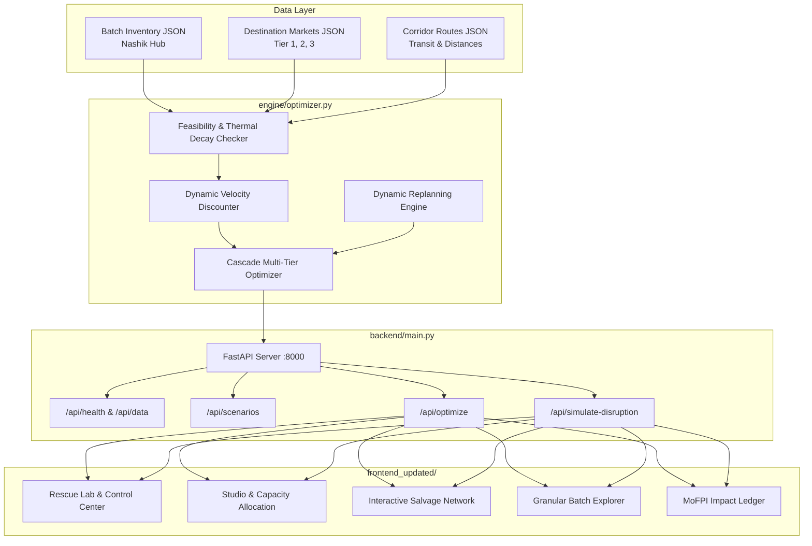

# Cascade Salvage

> **Where Every Harvest Outruns Its Expiry.**  
> An AI-powered perishable resource recovery and distribution platform that dynamically re-routes agricultural produce across a three-tier salvage hierarchy before biological breakdown occurs.

[](https://www.python.org/)
[](https://fastapi.tiangolo.com/)
[](#)
[](#)
[](#)
[](#)

---

## 📌 Executive Summary

India's post-harvest produce logistics suffers from systemic, preventable spoilage. Traditional distribution systems dispatch commodities using rigid **First-In, First-Out (FIFO)** logic or static contracts. When unexpected logistics bottlenecks strike (such as monsoon highway flooding or terminal market congestion), produce fails destination acceptance criteria and is dumped as total waste.

**Cascade Salvage** replaces static distribution with a **dynamic, shelf-life-aware three-tier decision engine**:
1. **Tier 1 — Premium Retail:** High-grade, peak-freshness produce dispatched to premium supermarket chains (e.g., Nature's Basket, Reliance Fresh) capturing maximum margin.
2. **Tier 2 — Rapid Mandi:** Time-sensitive batches routed to high-velocity wholesale mandis and quick-commerce dark stores with automated **Dynamic Velocity Discounting** to guarantee fast clearance.
3. **Tier 3 — Processing Plants:** Produce nearing expiration or bearing cosmetic defects is dynamically salvaged to commercial food processing plants (e.g., Kissan Puree, Mapro Agro) for conversion into puree, pulp, juice concentrates, and pastes.

---

## 🏛️ System Architecture



---

## ⚡ Key Live Scenarios Supported

The platform features built-in multi-scenario stress-testing to validate supply chain resilience:

| Scenario Preset | Conditions Simulated | Conventional Baseline Loss | Cascade Salvage Outcome |
| :--- | :--- | :--- | :--- |
| **Standard Operations** | Clear logistics corridors from Nashik agricultural hub across 5 key destinations (13,000 kg). | 4,500 kg spoiled (34.6%) | **500 kg spoiled (3.8%)**<br/>**88.9% Waste Reduction**<br/>**+40.3% Revenue Surge** |
| **Monsoon Rain Delay** | Severe Western Ghats flooding, +8h to +14h corridor delays, accelerated moisture decay. | 9,000 kg spoiled (69.2%) | **3,700 kg spoiled (28.5%)**<br/>**58.9% Waste Reduction**<br/>**+159.5% Revenue Surge** |
| **Bumper Harvest Glut** | Market saturation with 19,000 kg inventory crashing mandi prices. | 14,000 kg spoiled (73.7%) | **7,200 kg spoiled (37.9%)**<br/>**48.6% Waste Reduction**<br/>**+167.7% Revenue Surge** |
| **Live Disruption Simulation** | Interactive parameter injection (e.g. +6h highway jam on all corridors). | Severe rejection at Tier 1 retail | **Instant re-routing of tomatoes to Kissan Puree & velocity discounting on bananas.** |

---

## 📂 Repository Layout

```text
cascade-salvage/
├── README.md                      # Primary project documentation (you are here)
├── requirements.txt               # Top-level dependencies for quick environment setup
├── backend/
│   ├── main.py                    # FastAPI service exposing endpoints and scenario loader
│   └── requirements.txt           # Backend-specific package pins
├── data/
│   ├── sample_batches.json        # Contract-locked Nashik produce batches (13,000 kg)
│   ├── sample_destinations.json   # Tier 1, 2, and 3 market destinations
│   ├── sample_routes.json         # Transit corridors, distances, and baseline travel times
│   └── scenarios/
│       ├── rain_delay_batches.json     # Monsoon delay batch dataset
│       ├── rain_delay_routes.json      # Waterlogged corridor routes
│       └── harvest_glut_batches.json   # 19,000 kg bumper surplus dataset
├── docs/
│   ├── DEVFOLIO_SUBMISSION.md     # Hackathon submission summary and problem alignment
│   └── README.md                  # Extended specifications archive
├── engine/
│   ├── optimizer.py               # Core three-tier cascade optimization & dynamic replanner
│   ├── test_optimizer.py          # Contract and algorithmic test suite
│   └── test_scenarios.py          # Ingestion and disruption scenario tests
├── frontend_updated/              # Modern flagship responsive dashboard (used in demo video)
│   ├── index.html                 # Semantic HTML5 application layout
│   ├── styles.css                 # Custom glassmorphic styling, design system, and dark theme
│   ├── app.js                     # Live API consumer, reactive state, charts, and network map
│   ├── demo-snapshots.js          # Offline fallback snapshots matching backend outputs
│   └── assets/                    # Favicon, logo, and local branding assets
```

---

## 🚀 Quickstart Guide

### 1. Prerequisites
- **Python 3.10+**
- Standard web browser (Chrome, Edge, Firefox, Safari)

### 2. Setup Virtual Environment & Install Dependencies
```bash
# Clone the repository
git clone https://github.com/ABHISHEK-M-S-05/cascade-salvage-freshroute.git
cd cascade-salvage-freshroute

# Create and activate virtual environment
python -m venv .venv

# On Windows (PowerShell):
.venv\Scripts\Activate.ps1
# On macOS / Linux:
source .venv/bin/activate

# Install required dependencies
pip install -r requirements.txt
```

### 3. Launch the Backend Server
```bash
python -m uvicorn backend.main:app --host 0.0.0.0 --port 8000 --reload
```
- **API Root:** [http://localhost:8000/](http://localhost:8000/)
- **Health Check:** [http://localhost:8000/api/health](http://localhost:8000/api/health)
- **Interactive Swagger Docs:** [http://localhost:8000/docs](http://localhost:8000/docs)

### 4. Launch the Flagship Dashboard
Open a separate terminal window in the project root:
```bash
python -m http.server 3000 --directory frontend_updated
```
Now visit **[http://localhost:3000](http://localhost:3000)** in your browser.

### 5. Run the Automated Test Suite
All 10 unit and scenario tests can be executed with zero external test runners:
```bash
# Run using Python's built-in unittest discovery:
python -m unittest discover -s engine -p "test_*.py"

# Or run each test suite directly:
python engine/test_optimizer.py
python engine/test_scenarios.py
```

---

## 📡 API Reference

| Method | Endpoint | Description |
| :--- | :--- | :--- |
| `GET` | `/` | API status and optimizer availability check. |
| `GET` | `/api/health` | Comprehensive health check and data loading verification. |
| `GET` | `/api/data` | Returns baseline batches, destinations, and route networks. |
| `GET` | `/api/scenarios` | Lists available simulation presets (`default`, `rain_delay`, `harvest_glut`). |
| `POST` | `/api/optimize` | Runs the three-tier cascade optimizer on current or custom scenario data. |
| `POST` | `/api/simulate-disruption` | Injects corridor delays, transit disruptions, and calculates isolated replanning. |

---

## 📊 Scientific & MoFPI Benchmark Alignment

India's **Ministry of Food Processing Industries (MoFPI)** post-harvest research surveyed **54 commodities across 15 agro-climatic zones**, establishing that agricultural loss varies dramatically by commodity physiology, transit duration, and local weather patterns.

Cascade Salvage encodes these findings directly:
- **Biological Decay Curves:** Thermal sensitivity models accounting for temperature breaks during inter-city transit.
- **Economic Value Preservation:** Converting what would have been a 100% loss at retail gates into valuable input stock for processing infrastructure.
- **70%+ Demand Fulfillment:** Balancing regional demand constraints without flooding local wholesale markets.

---

## 👥 Hackathon Team

Developed for the **Wild Bugs Devfolio Hackathon** (Problem Statement 03: *FreshRoute - Perishable Produce Distribution*).
- **GitHub Repository:** [ABHISHEK-M-S-05/cascade-salvage-freshroute](https://github.com/ABHISHEK-M-S-05/cascade-salvage-freshroute)
- **Status:** Complete, tested, fully operational.
