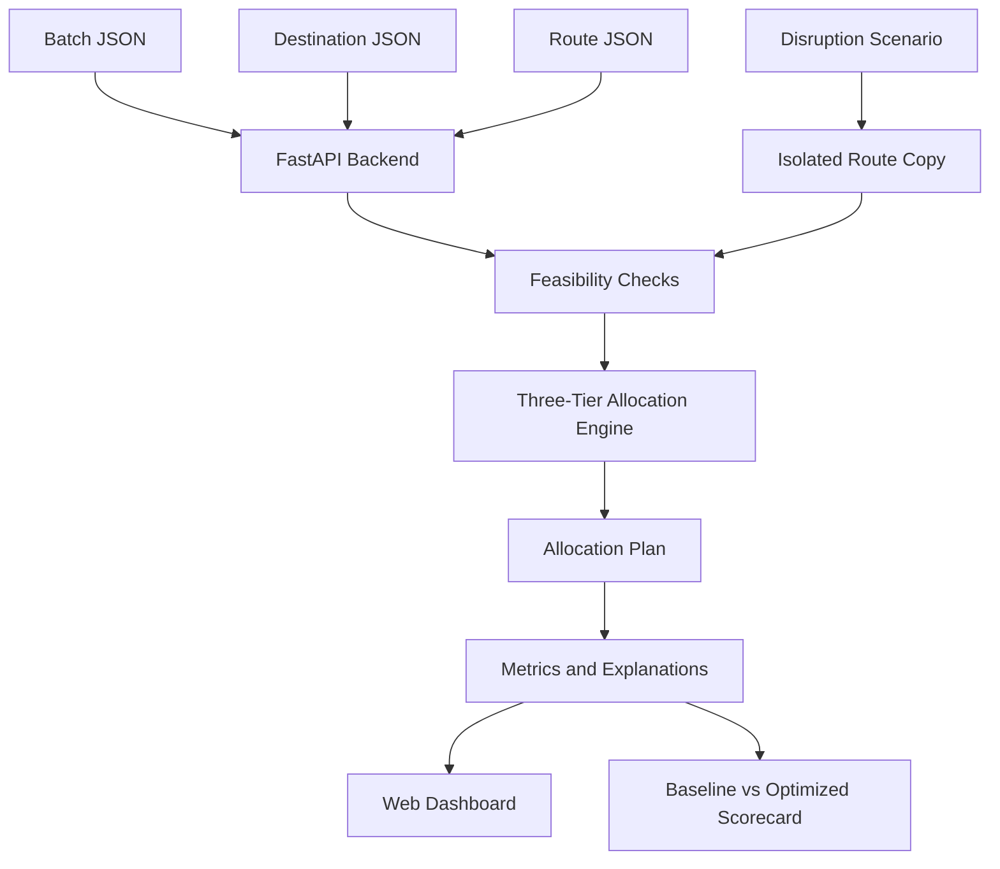

# Cascade Salvage
### Where Every Harvest Outruns Its Expiry.

[](https://www.python.org/)
[](https://fastapi.tiangolo.com/)
[](#)
[](#)
[](#)

**Cascade Salvage** is a decision-support prototype for allocating perishable produce to suitable destinations based on shelf life, quality, demand, transit time, and recoverable economic value. It uses a three-tier cascade: premium retail, rapid distribution, and processing recovery.

> This repository is a hackathon prototype. Outcomes depend on the supplied data and model assumptions; the system does not replace food-safety checks or operational expertise.

## The Problem

Fruits and vegetables can lose value while waiting for buyers or transport. Fixed distribution patterns, changing demand, and delivery delays can cause avoidable spoilage. A batch rejected by a premium retailer may still be suitable for a mandi or an approved processor—if it can arrive in time and meets acceptance requirements.

India's MoFPI-related post-harvest loss research has examined **54 commodities across 15 agro-climatic zones**, highlighting the need to account for differences between commodities and regions. Loss estimates depend on study methodology and conditions; they should not be treated as one universal rate.

## The Three-Tier Cascade

| Tier | Destination type | Decision goal |
|---|---|---|
| **Tier 1 - Premium Retail** | Supermarkets and premium retailers | Preserve quality and recover higher suitable prices |
| **Tier 2 - Rapid Mandi** | Mandis, local markets, quick-commerce hubs | Move eligible, time-sensitive inventory quickly; consider discounts |
| **Tier 3 - Processing Plant** | Eligible food processors | Recover value from produce unsuitable for conventional retail, subject to acceptance and food-safety criteria |

The optimizer should allocate only to feasible destinations, respect demand limits, and attempt alternative feasible destinations before classifying a remainder as unallocated.

## Architecture



## Repository Layout

```text
cascade-salvage/
├── README.md
├── data/
│   ├── sample_batches.json
│   ├── sample_destinations.json
│   └── sample_routes.json
├── engine/
│   └── optimizer.py
├── backend/
│   └── main.py
├── frontend/
│   ├── index.html
│   ├── styles.css
│   └── app.js
└── docs/
    ├── DEVFOLIO_SUBMISSION.md
    └── DEMO_SCRIPT.md
```

File names may vary slightly in a particular branch; adjust commands to match the repository.

## Shared Data Contract

Do not rename these locked JSON keys without agreement from the team.

### Batch

```json
{
  "batch_id": "B001",
  "commodity": "Tomato (Hybrid)",
  "quantity_kg": 2500,
  "shelf_life_hrs": 18.0,
  "quality_grade": "B",
  "base_cost_per_kg": 15.0
}
```

### Destination

```json
{
  "dest_id": "D4",
  "name": "Kissan Food Processing Hub",
  "tier": "Tier 3 - Processing Plant",
  "demand_kg": 5000,
  "offering_price_per_kg": 18.0,
  "min_shelf_life_hrs": 8.0,
  "distance_km": 40,
  "transit_time_hrs": 1.5,
  "transport_cost_per_kg": 1.2
}
```

The `tier` value must be exactly one of:
- `Tier 1 - Premium Retail`
- `Tier 2 - Rapid Mandi`
- `Tier 3 - Processing Plant`

## API Documentation

Base URL for local development: `http://localhost:8000`

### `GET /`
Returns service information.

### `GET /api/health`
Returns API/optimizer health information.

### `GET /api/data`
Returns the batch, destination, and route datasets used by the application.

### `GET /api/stats`
Returns summary statistics for the current dataset.

### `POST /api/optimize`
Runs the allocation engine.

Example request (if the backend accepts an empty JSON object):

```bash
curl -X POST http://localhost:8000/api/optimize \
  -H "Content-Type: application/json" \
  -d '{}'
```

Expected response shape:

```json
{
  "allocations": [
    {
      "batch_id": "B001",
      "commodity": "Tomato (Hybrid)",
      "dest_id": "D4",
      "dest_name": "Kissan Food Processing Hub",
      "tier": "Tier 3 - Processing Plant",
      "allocated_kg": 2500,
      "action": "SALVAGE_RECOVERY",
      "discount_pct": 0.0,
      "effective_price_per_kg": 18.0,
      "transport_cost_per_kg": 1.2,
      "net_profit": 42000.0,
      "margin_hrs": 16.5,
      "status": "SAVED",
      "reasoning": "Illustrative explanation; actual text should be generated from the live decision."
    }
  ],
  "metrics": {
    "baseline_spoilage_kg": 3200.0,
    "baseline_spoilage_pct": 24.6,
    "baseline_net_revenue": 142000.0,
    "optimized_spoilage_kg": 450.0,
    "optimized_spoilage_pct": 3.5,
    "optimized_net_revenue": 194500.0,
    "spoilage_reduction_pct": 85.8,
    "revenue_gain_pct": 37.0,
    "demand_fulfillment_pct": 92.4
  }
}
```

**Important:** The values above describe the agreed response shape and an illustrative example; they are not guaranteed live results. Confirm the backend's request schema before relying on `{}`. Keep response field names consistent with the team's locked contract.

### `POST /api/simulate-disruption`
Simulates a disruption and re-runs optimization. Supported fields depend on the backend implementation; the current design uses concepts such as `delay_hrs`, `disruption_type`, and `affected_dest_id`.

Example request (adapt to the exact backend schema):

```json
{
  "disruption_type": "highway_jam",
  "delay_hrs": 6,
  "affected_dest_id": "D4"
}
```

The expected behavior is to apply the delay to an isolated working copy of route data, recalculate feasibility and allocations, and return revised allocations and metrics. The original baseline routes should remain unchanged.

## Quickstart

### Requirements

- Python 3.10 or newer
- `pip`
- A modern browser
- The repository's data files and dependencies

### 1. Clone and enter the repository

```bash
git clone <YOUR_REPOSITORY_URL>
cd cascade-salvage
```

Replace `<YOUR_REPOSITORY_URL>` with the actual Git repository URL.

### 2. Create a virtual environment

**Windows (PowerShell):**
```powershell
py -m venv .venv
.venv\Scripts\Activate.ps1
```

**macOS / Linux:**
```bash
python3 -m venv .venv
source .venv/bin/activate
```

### 3. Install dependencies

If the repository contains `requirements.txt`:

```bash
pip install -r requirements.txt
```

Otherwise install the packages required by the backend, for example:

```bash
pip install fastapi uvicorn
```

Install `pytest` as well if you want to run tests.

### 4. Start the backend

Run from the repository root, adjusting the import path if your actual file/module name differs:

```bash
uvicorn backend.main:app --reload --host 0.0.0.0 --port 8000
```

Open:
- API root: `http://localhost:8000/`
- Health: `http://localhost:8000/api/health`
- Interactive API docs: `http://localhost:8000/docs`

If the command fails, check the package layout and use the module path matching the location of `main.py`.

### 5. Start the frontend

For a static HTML frontend, open `frontend/index.html` in a browser or serve it locally:

```bash
python -m http.server 5500 --directory frontend
```

Then open `http://localhost:5500`.

If the frontend uses `http://localhost:8000` as its API base URL, keep the backend running on port 8000. For deployment, configure the frontend to use the deployed backend URL instead of `localhost`.

### 6. Run tests

If tests are included:

```bash
pytest -q
```

### 7. Try the demo

1. Open the dashboard and inspect the inventory.
2. Run the baseline and optimized allocation.
3. Inspect allocations across the three tiers.
4. Trigger a highway-jam scenario.
5. Compare the revised plan and scorecard.
6. Verify that the original baseline remains unchanged after the simulation.

## Metric Definitions

Document the exact formulas used by the implementation. In particular:

- **Unallocated/spoilage quantity:** inventory that cannot be assigned to any feasible destination under the model's rules. This is a model estimate, not a direct measurement of physical spoilage.
- **Demand fulfillment:** allocated quantity divided by the relevant demand denominator, clearly defined in the implementation.
- **Revenue:** quantity multiplied by effective selling price.
- **Contribution after transport:** revenue minus transport cost.
- **Contribution after acquisition and transport:** revenue minus acquisition and transport costs.

Do not label revenue minus transport cost as full net profit if acquisition costs and other relevant expenses are excluded.

## Responsible Use and Limitations

- A mathematically feasible allocation does not prove that produce is food-safe.
- Processing destinations must apply their own acceptance and food-safety criteria.
- Predictions depend on the quality of input data and the assumptions encoded in the optimizer.
- Clearly label mock/fallback data; never present it as a live optimization result.
- Report baseline and optimized metrics using consistent assumptions.

## Team

Built by the Cascade Salvage team for the Wild Bugs Devfolio Hackathon.

## License

Add the license chosen by your team before public release.
